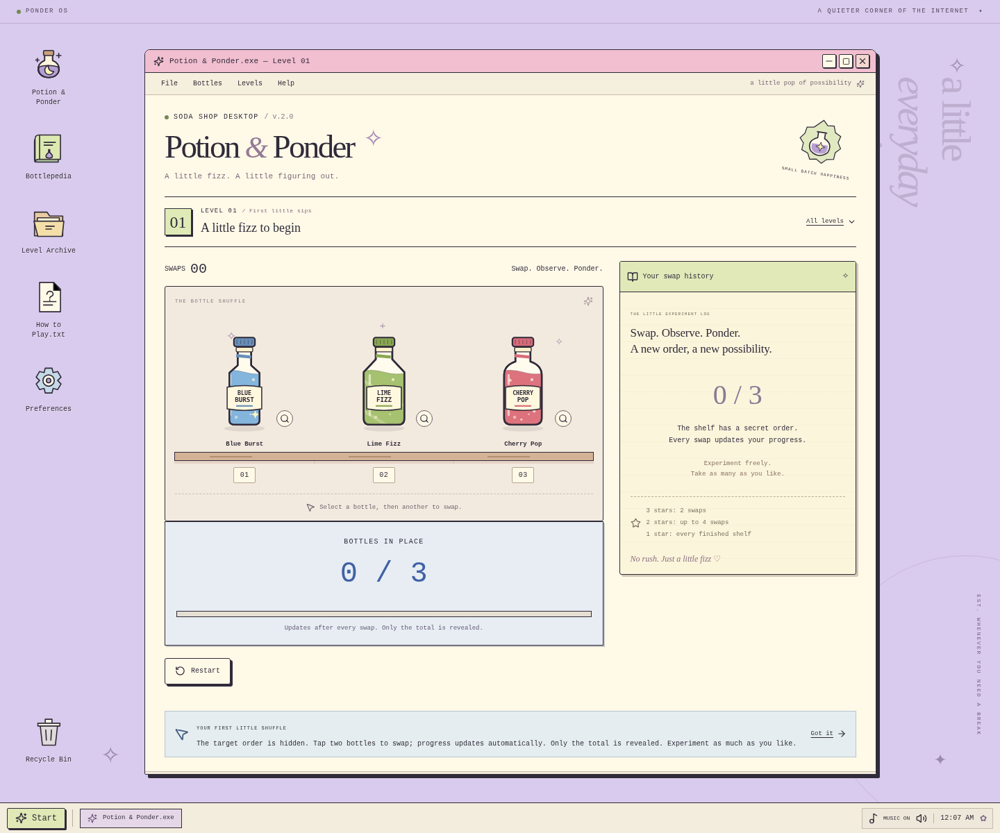

# Potion & Ponder

A retro-inspired bottle-swapping puzzle game built with React and TypeScript. Rearrange original illustrated soda bottles, follow the live position count, and solve fifteen increasingly challenging shelves inside a pastel desktop inspired by Windows 95.

**[Play the live demo](https://potion-and-ponder.vercel.app/)**



## Features

- **15 puzzle levels:** progress from three to nine uniquely identifiable bottles.
- **Automatic feedback:** every swap updates the total number of bottles in place. The target order and individual matches remain hidden.
- **Relaxed play:** no hints, heart penalties, timers, manual submission, or game-over screens.
- **Original artwork:** ten fictional soda brands with custom SVG bottles, labels, colors, and cap details.
- **Retro desktop:** draggable, stackable application windows, a taskbar, Bottlepedia, a level archive, and preferences.
- **Original audio:** a synthesized eight-bar instrumental, soft sound effects, independent toggles, and music volume control.
- **Persistent progress:** unlocked levels, best stars, best swap counts, and preferences saved locally, with safe migration from older saves.
- **Responsive controls:** desktop and touch interaction, keyboard support, and reduced-motion preferences.

## Tech stack

| Area | Technologies |
| --- | --- |
| Application | React 19, TypeScript, Vite |
| Interface | Tailwind CSS, custom CSS, Motion, Lucide icons |
| Artwork and audio | Original SVG illustrations, Web Audio API synthesis |
| Persistence | Browser localStorage |
| Testing | Vitest, Playwright |
| Hosting | Vercel |

The game is entirely client-side. No API keys, backend, external fonts, or downloaded music assets are required.

## Run locally

Use Node.js **22.12+** and npm; the project has been validated with Node 24.

```sh
git clone https://github.com/drunkmonkkk/portion-ponder.git
cd portion-ponder
git switch work
npm install
npm run dev
```

Open the local URL printed by Vite, normally `http://localhost:5173`. The complete application currently lives on the `work` branch. For reproducible installs using the committed lockfile, use `npm ci`.

## Production build

```sh
npm run build
npm run preview
```

The build runs TypeScript checks and generates `dist/`. Vercel uses the committed [deployment configuration](vercel.json). See [DEPLOYMENT.md](DEPLOYMENT.md) for hosting details.

## How to play

1. Select a bottle, then select another bottle to swap their positions. Select the same bottle twice to deselect it.
2. After the swap animation, **BOTTLES IN PLACE** updates automatically. Only the total is revealed; no individual bottle is marked correct.
3. Use the totals and swap history to experiment with the hidden order. The target stays fixed when restarting a level.
4. Place every bottle correctly to complete the level automatically and unlock the next shelf.

Three stars require the minimum number of swaps, calculated from permutation cycles. Two stars allow that minimum plus `max(2, ceil(bottleCount / 2))`; every other completion earns one star. Your highest rating and lowest swap count are saved independently.

Music starts after your first interaction, continues across levels and windows, and pauses when the tab is hidden. Use the taskbar music toggle or Preferences to adjust volume and sound effects.

Progress belongs to the browser and website origin. Unfinished shelves restart on refresh; completed levels and preferences persist. If storage is blocked, the game remains playable with session-only progress and displays a notice. Old v1 saves remain untouched when migrating to the newer puzzle format.

## Tests

```sh
npm test
npx playwright install chromium
npm run test:e2e
```

The 29 unit tests cover position matching, immutable swaps, deterministic shuffles, minimum swaps, ratings, save migration, and original audio synthesis. Nine browser scenarios cover all fifteen levels, live feedback, animation guards, automatic completion, persistence, desktop windows, mobile touch controls, and music playback.

Playwright uses `/usr/bin/chromium` when available and otherwise uses its installed Chromium browser. Set `CHROMIUM_PATH` to use a different executable. It starts the development server automatically; `PLAYWRIGHT_BASE_URL` can point to an existing preview or deployment instead. Failure screenshots and traces are generated in ignored test-artifact directories.

## Project structure

```text
src/
  components/    Windows, game interface, original SVG bottles, and dialogs
  data/          Soda identities and fifteen level configurations
  hooks/         Game state, desktop window management, and audio lifecycle
  utils/         Puzzle logic, versioned saves, audio synthesis, and unit tests
  styles.css     Retro interface and responsive styles
public/          Static favicon
tests/          Browser gameplay and audio scenarios
```

The bottle illustrations are React SVG components, and music and sound effects are generated in code, so there are no missing external media dependencies.
